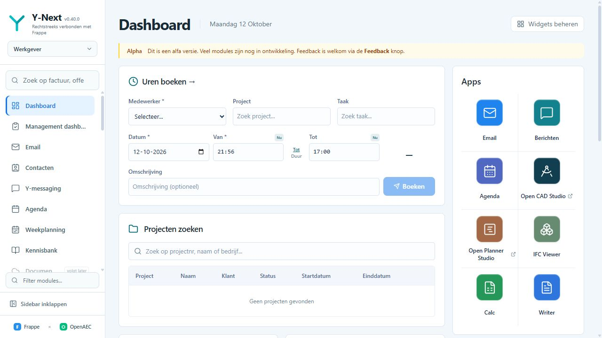
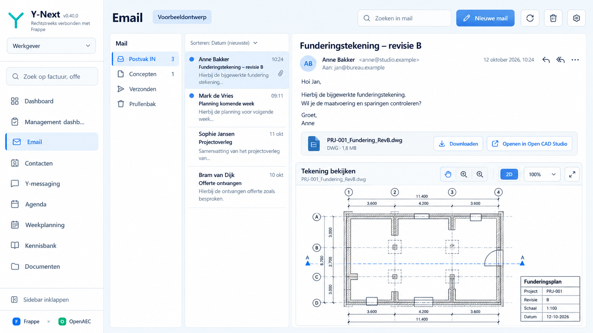
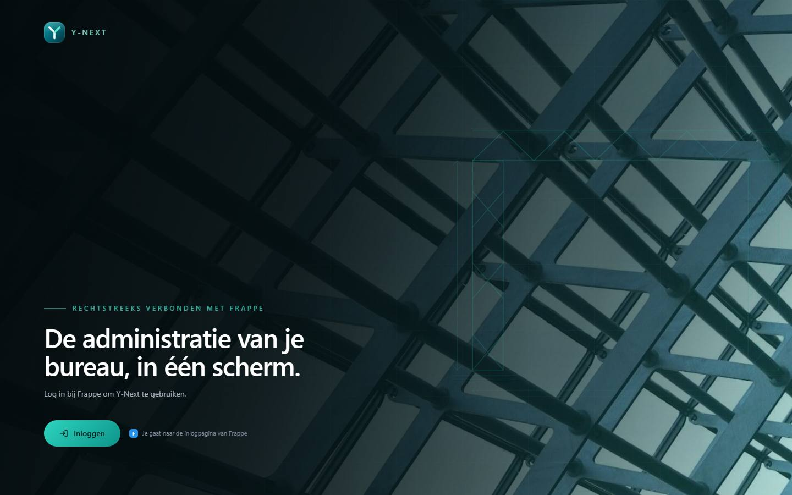
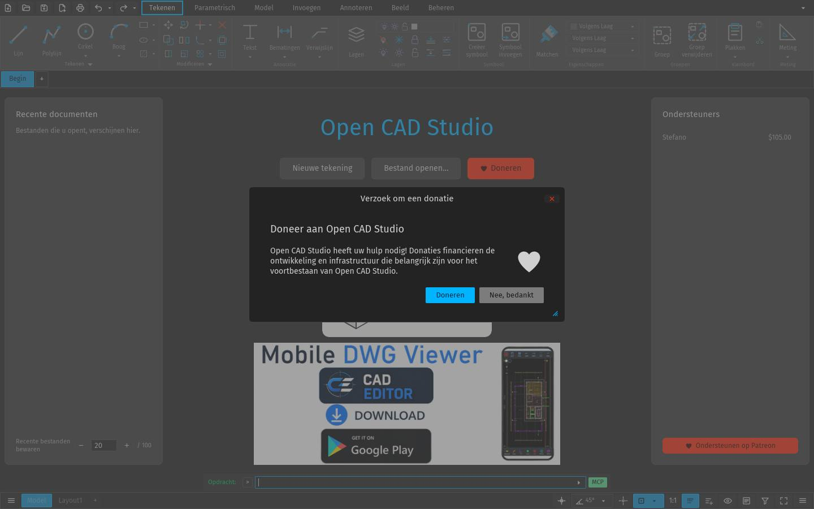

# Y-next

**Web app voor ERPNext 16**, met projecten, uren, mail en documenten op de
eigen ERPNext-site. Y-next gebruikt de bestaande login en ERPNext-rechten.

Y-next wordt geleverd als de Frappe-app `y_next`. De release bevat de gebouwde
browserinterface en de bijbehorende Python-functies voor Frappe. Bestanden en
gegevens blijven op je eigen site; een aparte Y-next-server of account is
niet nodig. De browserinterface gebruikt de API van diezelfde site.

## Lichte werkplek



Screenshot van de lokale ontwikkelbuild. De lege testsite bevat nog geen
medewerkers of projecten; de interface toont geen fictieve bedrijfsgegevens.
Het dashboard heeft een centrale werkplek en een Apps-paneel met Calc en Writer.
Op smalle schermen staan de Apps boven de dashboardwidgets.

## Mail met een DWG-bijlage — ontwerpbeeld



Gegenereerd ontwerpbeeld met volledig fictieve afzenders, mailtekst en
tekening. Dit is geen live screenshot en geen bewijs dat de getoonde
DWG-preview al op iedere installatie beschikbaar is.

## Downloaden en installeren

Er zijn twee manieren om dezelfde app te installeren:

1. **Zelf installeren:** download een release of haal de app met Bench op.
2. **Via Claude:** geef je Claude Code-sessie de repository en de
   installatieopdracht hieronder.

De [app-repository](https://github.com/OpenAEC-Foundation/y_next) bevat het
installeerbare pakket. Deze bronrepository is voor ontwikkeling.

### Route 1: installeer de app

Open de [releases](https://github.com/OpenAEC-Foundation/y_next/releases) en
kies een versie. De huidige gepubliceerde versie is
[v0.40.0](https://github.com/OpenAEC-Foundation/y_next/releases/tag/v0.40.0).
Via **Source code (zip)** kun je het volledige pakket downloaden, inclusief
de gebouwde frontend. De repository is momenteel privé: downloaden en
installeren vraagt een GitHub-account met toegang.

Voer in een bestaande Frappe-bench met Frappe 16 en ERPNext 16 uit:

```bash
bench get-app --branch version-16 https://github.com/OpenAEC-Foundation/y_next
bench --site jouw.site install-app y_next
bench --site jouw.site list-apps
```

Vervang `jouw.site` door de sitenaam. Open vervolgens
`https://jouw.site/y-next` en log in met je bestaande ERPNext-account.
Je hebt toegang tot de bench of een hostingbeheerder nodig voor installatie.
De gebruiksklare app draait daarna in de browser.

### Route 2: laat Claude de app importeren

Start Claude Code in de omgeving waar je bench bereikbaar is en plak deze
opdracht. Vul eerst de twee placeholders in:

```text
Installeer Y-next uit https://github.com/OpenAEC-Foundation/y_next,
branch version-16, op mijn bestaande lokale ERPNext 16-testsite.
Bench-map: <pad-naar-mijn-bench>
Site: <mijn-testsite>

Lees eerst de README van de app. Controleer de Frappe- en ERPNext-versies,
de toegang tot de repository en of y_next al op de site staat.
Gebruik de gebouwde distributie. Als de app nog niet op de bench staat,
haal haar op met bench get-app; installeer haar op de genoemde site.
Controleer daarna list-apps en open /y-next met de bestaande ERPNext-login.
Rapporteer de geïnstalleerde versie en de lokale URL.
Bij een bestaande installatie: controleer eerst de versie; overschrijf of
update haar niet automatisch. Vraag alleen om informatie die ontbreekt.
```

Deze opdracht helpt bij het importeren van de app; Claude heeft dezelfde
repository- en bench-toegang nodig als bij handmatige installatie. Geheimen
horen in de normale lokale aanmelding of secretconfiguratie.

Volledige installatie-, instellingen- en update-informatie staat in de
[README van de app](frappe-app/README.md). De technische ontwikkelwerkwijze
staat in [docs/frappe-app.md](docs/frappe-app.md).

## Apps op het startscherm

Het dashboard bevat snelkoppelingen naar Email, Berichten, Agenda,
Open CAD Studio, Open Planner Studio, IFC Viewer, Calc en Writer.
Uren boeken en de projecttabel staan centraal, met kilometerregistratie en
persoonlijke taken eronder. De Apps en Agenda vandaag staan rechts.

Email, Berichten en Agenda gebruiken dezelfde ERPNext-sessie en rechten.
Writer en Calc starten een nieuw lokaal document; bestaande bijlagen openen
via hun project of e-mail. De IFC Viewer opent een lokaal model (.ifc,
maximaal 100 MB) zonder het bestand te uploaden.

CAD opent de lokale viewer als die op de site beschikbaar is, anders de
online Open CAD Studio. Planner opent de online Open Planner Studio.
Deze twee links openen in een nieuw tabblad; documenten en aanmeldgegevens
worden niet aan de externe studio meegegeven.

## Calc en Writer

De gepubliceerde versie 0.40.0 toont Office-bijlagen als leesvoorbeeld.
Deze ontwikkelversie bevat geïntegreerde editors:
`.docx` voor Writer en `.xlsx`/`.xlsm` voor Calc. De flow is openen
vanuit mail, project of een lokaal bestand, bewerken in de browser en als
nieuwe private bestandsversie opslaan. Het origineel blijft beschikbaar;
een ontvangen bericht wordt niet gewijzigd of verzonden. Een werkboek met
macro's wordt als bestand bewaard, zonder macro's uit te voeren.

De editorinterface is beschikbaar in Nederlands, Engels en Duits.
Calc-getalinvoer gebruikt in deze preview een punt als decimaalteken
(`1234.5`); komma-invoer blijft tekst en formules gebruiken Engelse
functienamen. Complexe documenten kunnen functies bevatten die de editors
niet ondersteunen. Bewaar het origineel en controleer een nieuwe versie
voordat je die verder gebruikt; onbekende OOXML-onderdelen worden waar
mogelijk behouden en onveilige externe resources geweigerd.

Nieuwe Calc-werkboeken houden een leeg raster van 26 kolommen en 1.000 rijen
bereikbaar na invoer, opslaan en heropenen. Dit wordt niet automatisch aan
bestaande bestanden toegevoegd. De huidige editor toont nog geen zichtbare
rij- en kolomkoppen; het naamvak geeft de actieve cel aan.

De nieuwe lichte werkplek gebruikt gedeelde kleur- en typografietokens.
Het menu en dashboard zijn opnieuw vormgegeven zonder de bestaande
modulekeuzes, ERPNext-rechten of widgetinstellingen te vervangen.

Het editorontwerp staat in
[docs/superpowers/specs/2026-10-12-office-editors-design.md](docs/superpowers/specs/2026-10-12-office-editors-design.md).



---

## What Y-next is (and is not)

- One site, one Y-next installation: single-tenant, no instance switcher, no
  separate accounts.
- No sign-in form of its own: Y-next reuses the session of the site it is
  published on as a Web Page (route `/y-next`). When you are signed out it
  shows the screen above, which sends you to the Frappe sign-in page.
- All data — projects, invoices, mail, calendar, HR — comes straight from the
  REST API of that same site. No middle layer and no cache on a server of our
  own.
- No Express production server and no credential vault: those belonged to the
  original multi-instance Y-app architecture and do not apply to this fork.

---

## What it does

**Mail** — built on ERPNext `Communication` documents, so every message stays
linked to the project, customer or invoice it belongs to.

- Folders for inbox, sent, unread, handled and trash, plus folders per
  connection (project, customer, purchase invoice, sales invoice, quotation,
  lead).
- Search across subject, sender and recipients *and* across everything linked
  to a matching project or relation; picking a project or relation from the
  search bar opens its folder.
- Compose with a rich text editor, signatures generated from Frappe data,
  project linking, and drafts that live on the server instead of in one
  browser — so another tool (or an assistant) can prepare a message for you to
  review and send.
- Attachments open next to the mail: PDF, IFC models, Word/Excel/CSV
  (read-only) and DWG/DXF drawings, each in its own viewer, or full screen in
  a separate tab.
- Out-of-office replies, an importance flag, and a per-mail identifier you can
  copy to point at exactly one message.

**Calendar** — Frappe Events plus, where configured, the calendars on the mail
server (JMAP), with recurring appointments, duration presets, locations taken
from the address book, and a memory that fetches the weeks around the one you
are looking at.

**Drawings** — DWG and DXF open in [Open CAD Studio](https://www.opencadstudio.com/),
a WebAssembly CAD viewer hosted on the same site. It loads on the first drawing
you open, not before.



**Knowledge base** — a home page listing every article by topic, what changed
recently, and the articles you open most.

**And further** — dashboard, projects, tasks and planning, timesheets and
expenses, sales and purchase invoices, quotations, leads, HR, and the settings
screens.

Not active yet (they need a server or proxy): messages (NextCloud Talk),
documents (Nextcloud) and passwords.

`packages/server` and `packages/desktop` hold the original Y-app runtimes (the
Express backend and the Tauri desktop build). They are **not deployed** in this
fork, but stay in the repository because the messenger and the desktop variant
may return later.

---

## Development

```bash
npm install
npm run dev
```

Optional environment variables for local development:

| Variable | Default | Description |
|---|---|---|
| `VITE_ERPNEXT_URL` | `http://localhost:8000` | The site the Vite dev proxy talks to |
| `YNEXT_DEV_TOKEN` | — | Optional `key:secret` API token, added server-side by the dev proxy as an `Authorization` header only; it never reaches client code or the bundle |

Without `YNEXT_DEV_TOKEN`, ordinary cookie-based login through the site works
as well, because the dev server mimics the same origin behaviour as production.

## Testing

```bash
npm test
```

The suite is plain `node --test` over the TypeScript sources: pure modules with
no DOM, so the rules that decide what the app does are checked in milliseconds.

## De Frappe-app lokaal bouwen

Voor ontwikkeling zijn Node 24, de npm-afhankelijkheden en een lokale
Docker Compose-bench met Frappe 16 en ERPNext 16 nodig. In PowerShell:

```powershell
npm install
node scripts/build-frappe-app.mjs
$env:YNEXT_BENCH_DIR = 'C:\pad\naar\frappe-bench-v16'
$env:YNEXT_BENCH_SITE = 'jouw.localhost'
node scripts/dev-bench-sync.mjs --migrate
```

De sync vervangt de ontwikkelkopie van `y_next` op die lokale bench.
Gebruik dit uitsluitend op een testbench zonder ongekopieerde appwijzigingen.
Open daarna `http://jouw.localhost:8000/y-next`.
Zie [docs/frappe-app.md](docs/frappe-app.md) voor tests en het samenstellen
van de distributie. De oudere Web Page-publicatieroute staat beschreven in
[docs/deployment.md](docs/deployment.md); zij is niet de app-installatie.

---

## Credits

The sign-in screen uses a photo from [Unsplash](https://unsplash.com/photos/gray-metal-structure-during-daytime-VZYBvXoPBYA),
free to use under the Unsplash License.

## License

Copyright [OpenAEC Foundation](https://github.com/OpenAEC-Foundation).
